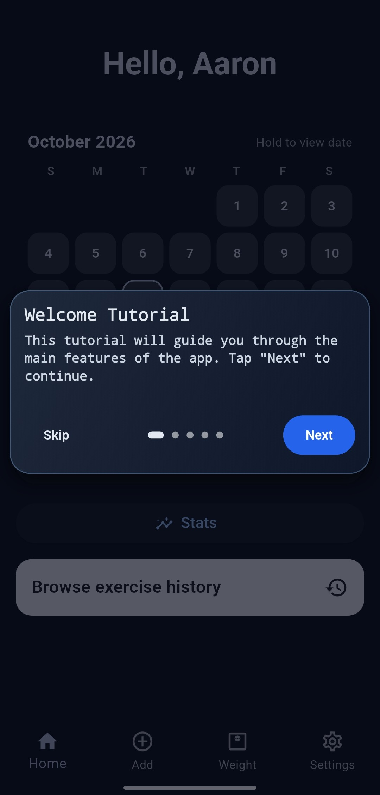
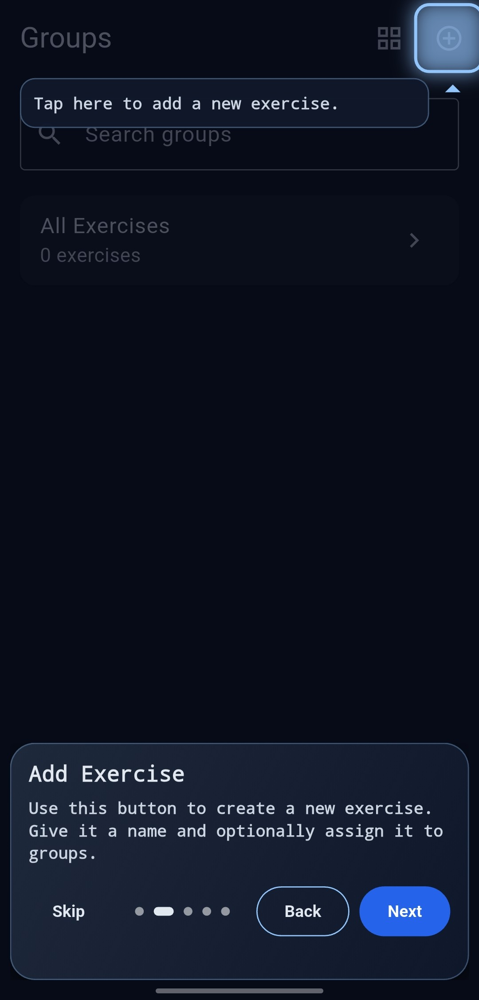
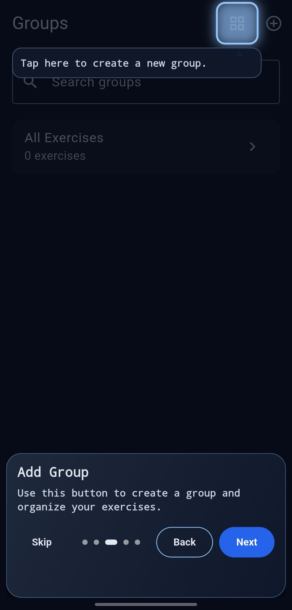
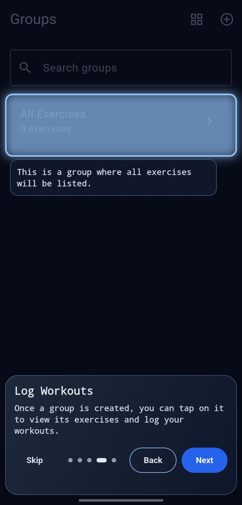
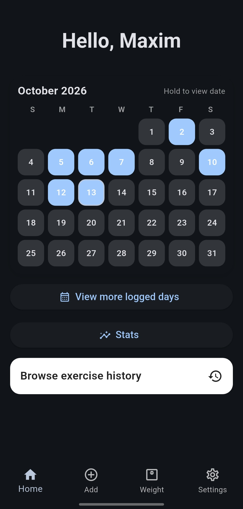
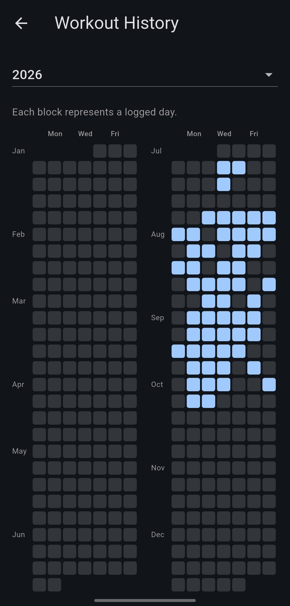
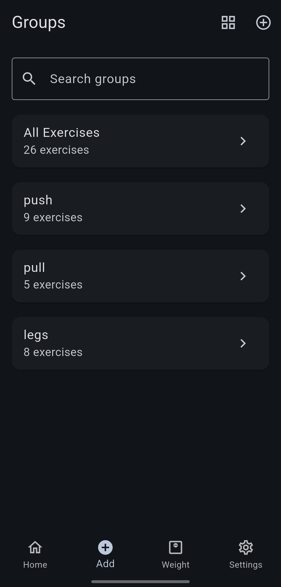
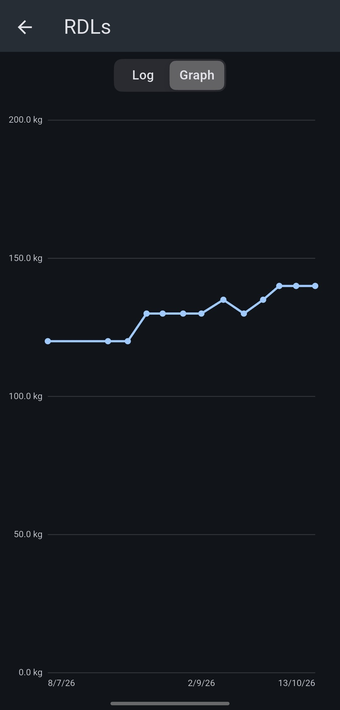

  

# Reptr

A simple, lightweight rep tracker that makes it easy to log weight and reps, with no subscriptions and no paywalled features.

## Why Reptr?

Every gym-goer has been there: you're about to load the bar for your top set and suddenly can't remember what you lifted last session. It breaks your rhythm and can stop you reaching your full potential.

Reptr remembers for you. It logs the weight and reps for every exercise so you never have to second-guess yourself. It's also free and open source, with no limits on custom exercises or the number of routines you can create.

## Features

- Track weight and reps for every exercise
- Calendar view of the days you've trained
- See your personal best weight for each exercise
- Log rest-pause sets and drop sets
- Progress graphs for each exercise
- Body-weight tracking, to see whether a diet change is working or to record your weight for exercises like pull-ups

## Screenshots

 &nbsp; &nbsp; 

 &nbsp; &nbsp;

 &nbsp; &nbsp;

 &nbsp; &nbsp; 

## Tech stack

Built with Dart and Flutter.

## Getting started

<!-- How to download/build, e.g. `flutter pub get` then `flutter run` -->

## License

<!-- e.g. MIT -->
